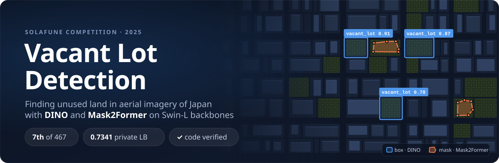

<p align="center">
  
</p>

<p align="center">
  
  
  
  
  
  
  <a href="LICENSE"></a>
</p>

<p align="center">
  <a href="#results"><b>Results</b></a> &nbsp;·&nbsp;
  <a href="#approach"><b>Approach</b></a> &nbsp;·&nbsp;
  <a href="#lessons"><b>Lessons</b></a> &nbsp;·&nbsp;
  <a href="#quickstart"><b>Quickstart</b></a> &nbsp;·&nbsp;
  <a href="docs/SOLUTION.md"><b>Full write-up</b></a>
</p>

---

This is my solution to the [Solafune **Vacant Lot Detection**](https://community.solafune.com/competitions/5026f2e0-0821-4b02-b09b-78b178482028?menu=about&tab=overview) challenge: find unused land in aerial imagery of Japan, both as **bounding boxes** and as **segmentation polygons**. I fine-tuned two transformer models: **DINO** for detection and **Mask2Former** for segmentation, both with Swin-L backbones. The full pipeline is packaged in Docker and runs as `preprocess → train → predict`. \
This solution was ranked **7th out of 467 teams** on the private leaderboard. It was scored **0.7341** on the private leaderboard and 0.7485 on the public leaderboard.

## Results

The top of the private leaderboard (467 competitors) was tight: 1st and 10th are only 0.11 apart. This entry uses a single model per task and no test-time augmentation, trained only on the competition data. It passed the organizers' code-verification step.

<details>
<summary><b>Top-10 private leaderboard scores</b></summary>

| Rank | Private LB score |
|:---:|:---:|
| 1 | 0.8157 |
| 2 | 0.8038 |
| 3 | 0.7895 |
| 4 | 0.7687 |
| 5 | 0.7580 |
| 6 | 0.7480 |
| **7 — this solution** | **0.7341** |
| 8 | 0.7282 |
| 9 | 0.7117 |
| 10 | 0.7033 |

</details>

## Approach

<p align="center">
  
</p>

Each submission answers **two tasks at once**. Detection is scored with F-β (β = 0.5), which weights precision more than recall. Segmentation is scored with pixel-level F1. The leaderboard ranks the **harmonic mean** of the two, so neither task can be neglected.

<table>
  <tr>
    <th width="50%">🟦 Detection — DINO</th>
    <th width="50%">🟧 Segmentation — Mask2Former</th>
  </tr>
  <tr valign="top">
    <td>

- **Backbone:** Swin-L (IN-22k), stages 0–1 frozen
- **Init:** full DINO-5scale COCO checkpoint
- **Data:** 90 % train split → 5 augmented copies per image
- **Input:** 1333 × 800
- **Train:** AdamW 3e-5 (backbone ×0.1), warmup + cosine, 5 epochs
- **Select:** best COCO bbox mAP on a 10 % hold-out
- **Post:** keep boxes with score ≥ 0.35

</td>
    <td>

- **Backbone:** Swin-L (IN-22k), stage 0 frozen
- **Init:** full Mask2Former ADE20K checkpoint
- **Data:** 90 % train split → original + 5 copies per crop
- **Input:** 256 × 256 random crops
- **Train:** AdamW 6e-5 (backbone ×0.1), poly LR, 15k iters
- **Select:** best mDice (≈ F1) on a 10 % hold-out
- **Post:** contours ≥ 10 px → simplified polygons

</td>
  </tr>
</table>

Both models train on a single RTX 3090 with batch size 1: about **4 h** for detection and **75 min** for segmentation.

## Lessons

- 🎯 **Tune for the metric.** F-β with β = 0.5 rewards precision over recall, so the detection score threshold matters. I tuned it to 0.35 using public-LB feedback.
- 🎨 **Gentle colour augmentation for segmentation.** The segmentation crops used much smaller hue/saturation shifts than detection (±3 / ±5 vs ±10 / ±15). The aim was to keep the subtle colour and texture cues that separate bare soil, gravel and grass from built-up land.
- 📏 **Select checkpoints on the scoring metric.** The segmentation checkpoint was chosen on validation mDice, which equals the pixel F1 used for scoring, rather than on mIoU.
- ❌ **TTA didn't help.** Horizontal flip plus multi-scale TTA, tried for both tasks, never beat single-pass inference on the public LB.
- 🐳 **The environment was the hardest part.** Getting MMCV CUDA ops, MMDetection, MMSegmentation and PyTorch 2.6 to work together in one container took more effort than the modelling.

Ideas I'd try next, such as fixing a train/test resize mismatch in detection, k-fold training and ensembling, are in the [full write-up](docs/SOLUTION.md#5-challenges-and-reflection).

## Quickstart

> [!IMPORTANT]
> **The competition data is not included.** Under the competition terms it is distributed only by Solafune and must be deleted after the competition. As the competition rules require, the following statement applies to the data and content provided by Solafune:
>
> cf. @solafune(https://solafune.com) Use for any purpose other than participation in the competition or commercial use is prohibited. If you would like to use them for any of the above purposes, please contact us.

**1. Lay out the data** like this:

```
data/
├── train_bbox_images/
├── train_segmentation_images/
├── evaluation_bbox_images/
├── evaluation_segmentation_images/
├── train_bbox_annotations.json
└── train_segmentation_annotations.json
```

**2. Build the image and start a container** with the data mounted:

```bash
docker buildx build -t vacant-lot-detection:latest .
```
```bash
docker run -it --gpus all -v $(pwd)/data:/app/data vacant-lot-detection:latest /bin/bash
```

**3. Run the pipeline** inside the container:

```bash
conda activate vld
bash run_preprocess.sh            # TIFF→PNG, annotations, offline augmentation
bash run_train_detection.sh       # DINO        (~4 h on an RTX 3090)
bash run_train_segmentation.sh    # Mask2Former (~75 min on an RTX 3090)
bash run_inference.sh             # → outputs/bbox.json, outputs/segmentation.json, submission.zip
```

Pretrained weights are downloaded automatically. Checkpoints go to `work_dirs/`.

> [!TIP]
> The image builds MMCV for `TORCH_CUDA_ARCH_LIST="8.6"` (RTX 30xx). On another GPU generation, change it in the [Dockerfile](Dockerfile).

<details>
<summary><b>Environment details</b></summary>

<br>

| Component | Version |
|---|---|
| Base image | `nvidia/cuda:12.6.3-cudnn-devel-ubuntu24.04` |
| Python | 3.11 (conda env `vld`) |
| PyTorch | 2.6.0 + cu126 |
| MMCV | 2.1.0, built with CUDA ops |
| MMEngine | latest via `mim` |
| MMDetection / MMSegmentation | cloned from source at build time |
| Developed on | Ubuntu 24.04, single RTX 3090 (24 GB) |

</details>

<details>
<summary><b>Running without Docker</b></summary>

<br>

The configs inherit from `../mmdetection/configs/...` and `../mmsegmentation/configs/...`. To run outside the container:

1. Clone both repositories into the project root (they are git-ignored) and install each with `pip install -e .`.
2. Install MMCV 2.1.0 with CUDA ops (`mim install "mmcv==2.1.0"`) and `pip install -r requirements.txt`.
3. Make sure `python3.11` resolves to your environment's interpreter, or edit the `run_*.sh` scripts.

</details>

<details>
<summary><b>Reproducibility notes</b></summary>

<br>

- Seeds are fixed (`seed=42` for the train/val splits and for MMEngine), but CUDA kernels and the random offline augmentations are not fully deterministic, so expect small score variations.
- The Dockerfile clones MMDetection and MMSegmentation at their latest commits. If an upstream change breaks the build, pin them to MMDetection v3.3.0 and MMSegmentation v1.2.2 (the current releases in mid-2025).
- The train and predict scripts patch `torch.load` to use `weights_only=False`. PyTorch 2.6 changed this default, which breaks loading MMEngine checkpoints.

</details>

## Repository layout

```
.
├── configs/
│   ├── dino_swinl_finetune_vacantlot.py            # detection: model, data, schedule
│   └── mask2former_swinl_finetune_vacantlot_seg.py # segmentation: model, data, schedule
├── src/
│   ├── preprocess_train_{detection,segmentation}.py  # TIFF→PNG, labels, train/val split
│   ├── augment_{detection,segmentation}_offline.py   # offline Albumentations
│   ├── train_{detection,segmentation}.py             # MMEngine Runner wrappers
│   └── predict_{detection,segmentation}.py           # inference → submission JSON
├── docs/
│   ├── SOLUTION.md                 # detailed technical write-up
│   └── assets/                     # README figures
├── run_preprocess.sh  ·  run_train_detection.sh  ·  run_train_segmentation.sh  ·  run_inference.sh
├── Dockerfile
├── requirements.txt
└── LICENSE  ·  NOTICE
```

## License

The code in this repository is licensed under the [Apache License 2.0](LICENSE), © 2025 Pranay Vandanapu. The configs are adapted from OpenMMLab's MMDetection and MMSegmentation configs, which are also Apache-2.0 (see [NOTICE](NOTICE)).

The license covers the code only. It does not cover the competition data or other content provided by Solafune, which is not included here and may not be redistributed.

## Acknowledgements

Thanks to [Solafune](https://solafune.com/) for hosting the competition and providing the dataset, and to [OpenMMLab](https://github.com/open-mmlab) for MMDetection, MMSegmentation, MMEngine and MMCV. The models build on [DINO](https://arxiv.org/abs/2203.03605), [Mask2Former](https://arxiv.org/abs/2112.01527) and [Swin Transformer](https://arxiv.org/abs/2103.14030).
